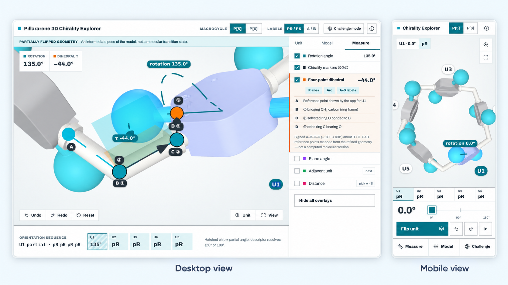

# Pillararene 3D Chirality Explorer

**An interactive 3D teaching tool for planar chirality in pillar[5]arene (P5) and pillar[6]arene (P6).**

Explore a modular, 3D-printable pillararene teaching model in a browser. Select and flip individual phenylene units, inspect their orientations, and use geometric overlays to connect physical molecular models with stereochemical reasoning.

> **Scientific scope:** Phase 1 is a *CAD-based educational model*, not an atomistic molecular simulation. Partially flipped geometries are not transition states, and model contacts are not calculated molecular energies.

## Launch

**[Open the web app (GitHub Pages)](https://nyelidl.github.io/pillarflip/)**  
**[GitHub repository](https://github.com/nyelidl/pillarflip)**

The GitHub Pages link is expected to work **after deployment is enabled and succeeds** for this repository. The public site was not independently verified when this README was prepared.

## Web App Preview

*Desktop four-point dihedral measurement and mobile P5 explorer interface.*

---

## Features

| Feature | What it does |
| --- | --- |
| **P5 and P6** | Switch between five- and six-phenylene macrocyclic models. |
| **Interactive view** | Orbit, pan, and zoom the 3D model. |
| **Select and flip** | Click/tap a phenylene unit to select it; double-click/double-tap or use the Flip button to flip it through 180°. |
| **Manual rotation** | Use a 0–180° slider and animation controls to inspect intermediate *model* orientations. |
| **Orientation labels** | Inspect the endpoint pR/pS labels under the app's stated stereochemical convention. |
| **Geometric overlays** | Where enabled in the build, inspect rotation, plane angles, distances, and a signed four-reference-point dihedral. |
| **Substituent models** | Show or hide arms and select available bead sizes. |
| **State controls** | Undo, redo, and reset. |

Additional challenge or measurement controls may vary with the deployed build.

## Quick start

1. Choose **P[5]** or **P[6]**.
2. **Click or tap** a phenylene unit to select it. Labels such as `U1` denote *whole phenylene units*.
3. **Double-click/double-tap** to flip the selected unit, or use **Flip selected unit**.
4. Move the **rotation slider** to explore intermediate teaching-model geometries.
5. Drag to orbit the camera; scroll or pinch to zoom.
6. Open **Geometry Measurements**, where available, to show reference points, lines, planes, and angle values.
7. Use **Undo**, **Redo**, or **Reset** to compare different arrangements.

On a touchscreen, the explicit Flip button can be easier to use than double-tapping.

## How to interpret the geometry

### Unit numbering versus stereochemical markers

- **U1, U2, ...** identify entire phenylene units.
- **①, ②, ③**, where displayed, identify stereochemical reference positions: the selected bridging CH₂ carbon (①), its bonded aromatic carbon (②), and the adjacent oxygen-substituted aromatic carbon (③), subject to the verified reference mapping.

These numbering systems have different meanings and should not be confused. Planar-chirality assignments also depend on the specified viewing direction and stereochemical convention.

### Rotation angle versus four-point dihedral

A **phenylene rotation angle** describes rotation of a CAD component about its model pivot. A **four-point dihedral** is defined by four ordered 3D points `A–B–C–D` and measured around the central `B–C` axis between planes `ABC` and `BCD`. Its sign depends on point order and the documented convention. A **plane angle** describes a separate measurement between selected reference planes.

The rotation slider value is **not automatically equal to an atomic torsion angle**. A dihedral derived from virtual CAD reference points is a geometric teaching measurement, not necessarily an atomic dihedral of an experimentally determined or quantum-chemically optimized structure.

### Partial rotations and endpoint chirality

When a unit is partway through a flip, the viewer depicts a **partially flipped geometry**. Do not interpret that configuration as a validated molecular transition state, a measured reaction intermediate, or a calculated activation barrier. Endpoint pR/pS assignments should be interpreted under the app's documented convention.

## Scientific limitations

- **Scale and shape:** Grey phenylene bodies, white CH₂ bridge frames, and cyan substituent arms/beads are components of a simplified physical teaching kit. Bead diameters and clearances do not quantitatively reproduce molecular van der Waals surfaces.
- **Contacts:** CAD steric contacts describe mechanical-model overlap or clearance, **not** molecular steric energy, conformational free energy, or actual flipping kinetics.
- **Coordinates:** Chemical interpretation of reference markers depends on a verified source-structure-to-CAD mapping. Do not assume a rendered marker corresponds to a particular atom without that mapping.
- **Energies:** Phase 1 does not establish Gaussian/DFT electronic energies, hydrogen-bond energetics, transition states, kinetic barriers, or solvent-dependent populations.
- **Validation:** The presence of a 3D viewer alone does not establish experimental validation, successful physical printing, or improved student learning outcomes. Refer to the project's scientific and QA reports for actual verification results.

## Suggested classroom activity

**Learning goal:** Use model manipulation and geometric reasoning to understand planar chirality and to distinguish different definitions of molecular orientation.

1. Predict the outcome of flipping one phenylene unit by 180°.
2. Perform the flip and compare the initial and final orientations.
3. Explore selected combinations of flips in P5, then compare with P6.
4. Identify the points used to define a planar-chirality reference sequence.
5. Explain why a signed dihedral requires **four ordered points** and why it differs from the slider rotation angle.
6. Explain why a partially rotated model is not evidence for a molecular transition state.

If the activity is evaluated as educational research, obtain any required ethics approval or exemption before collecting student data.

## Deploy on GitHub Pages

This is intended as a **static website**; the deployed viewer does not need a Python or Node.js backend.

1. Extract the deployment ZIP supplied with the application.
2. Upload the **extracted contents** into the repository, with `index.html` at the **repository root** and required JavaScript, CSS, GLB, and other assets in their intended relative paths. **Do not upload only the ZIP.**
3. In GitHub, open **Settings → Pages**.
4. Under **Build and deployment**, choose **Deploy from a branch**, then select **`main` → `/ (root)`** and save.
5. After the Pages deployment completes, visit **https://nyelidl.github.io/pillarflip/**.
6. Test P5/P6, selection, flipping, geometry measurements, and touch interaction on the published website.

**Base path:** Project Pages are served from `/pillarflip/`; asset URLs must resolve correctly under this path. Keep `.nojekyll` if it is included in the prepared deployment package.

An optional standalone offline HTML distribution may be supplied separately; it is not required for GitHub Pages.

## Source, validation, and reproducibility

For research or teaching reuse, keep a versioned archive of the relevant source code, CAD/GLB assets, reference-point mappings, scientific validation, browser QA results, and (when available) physical-print test results. The contents of those reports, not this README, establish which tests actually passed.

## Citation and license

When citing the tool, include the repository URL and the **specific release or commit** you used. A formal article citation can be added when published.

Check the repository's `LICENSE` file for reuse terms. **If no license is provided, public availability does not itself grant unrestricted permission to reuse or redistribute the code and assets.**

---

*Pillararene 3D Chirality Explorer · Phase 1 physical–digital educational platform*
